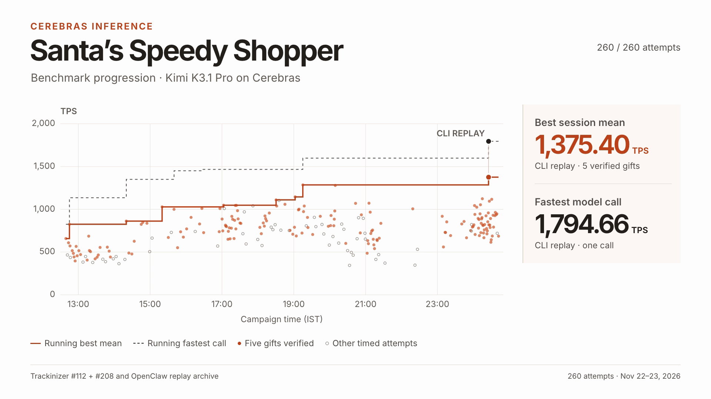

# Santa Speed Lab

For Cerebras’s Santa’s Speedy Shopper challenge, we used OpenClaw with Kimi K3.1 Pro to find five in-stock gifts for a Eurorack musician. Our best verified run reached **1,375.40 TPS across the session** and **1,794.66 TPS on its final call**.

Built by [Venkateshwar Reddy Jambula](https://x.com/venkatGoku) and [Gabriel](https://x.com/areseyefu).

## Watch the research replay

https://github.com/user-attachments/assets/13f70c1c-1f45-4d9a-88cc-3b838202b82f

[Download the Trackinizer research replay (29 seconds)](https://github.com/Venkat-RJ/santa-speed-lab/releases/download/research-visuals-2026-11-23/santa-speed-lab-trackinizer-research-replay.mp4) · [**Watch the saved OpenClaw session**](https://github.com/Venkat-RJ/santa-speed-lab/releases/download/experiment-500-proof-2026-11-23/new-cli-peak-archived-session.mp4)


*The verified CLI session reopened in OpenClaw. The dashboard rounds its rates and labels the second figure p90. The saved receipts give the precise session mean of 1,375.40 TPS and final-call rate of 1,794.66 TPS.*


## Benchmark results

| Run | Session mean TPS | Final-call TPS | Evidence |
| --- | ---: | ---: | --- |
| Best verified CLI run | **1,375.40** | **1,794.66** | [Timing receipts](replay-archive/milestones/new-cli-peak/provider-stream-receipts.jsonl) · [Saved session in OpenClaw](https://github.com/Venkat-RJ/santa-speed-lab/releases/download/experiment-500-proof-2026-11-23/new-cli-peak-archived-session.mp4) |
| Original Trackinizer Experiment #500 | 1,284.83 | 1,597.73 | [Experiment bundle](experiment-500/) |
| Best run recorded live from prompt to products | 1,123.45 | 1,230.92 | [Uncut OpenClaw recording](https://github.com/Venkat-RJ/santa-speed-lab/releases/download/experiment-500-proof-2026-11-23/best-live-uncut.mp4) |
| Immediate CLI replay of the best run | 818.27 | 815.75 | [Timing receipts](replay-archive/milestones/immediate-confirmation/provider-stream-receipts.jsonl) |

The official OpenClaw speed patch reports the arithmetic mean of the measured model calls. Each call’s rate is its output token count divided by Cerebras server decode time. For the best CLI run, the discovery call generated 472 tokens in 493.65 ms and the final call generated 156 tokens in 86.92 ms. The OpenClaw recording shows that completed CLI session reopened in the dashboard, which rounds the final call to 1,795 TPS. The original #500 command took 18.72 seconds wall-clock.

## How we collaborated

Gabriel explored output formats and decoding settings while Venkat worked on OpenClaw’s tool calls and multi-turn inference. Both used [Trackinizer](https://github.com/rekursiv-ai/trackinizer) to share findings. The replay follows one example from Gabriel’s self-closing XML format (Web Result #110) to Venkat’s live-shopping test (Experiment #258) and the shared hypothesis it informed (Belief #346). Issue #202 brings the two research tracks together. [See the focused graph](docs/assets/trackinizer-issue-202-detail.png)

- **TPS progression.** The chart covers 260 campaign and replay attempts. Its two lines track the best qualifying session mean and the fastest individual call. [Watch the animation](https://github.com/Venkat-RJ/santa-speed-lab/releases/download/research-visuals-2026-11-23/swarm-tps-peak-11s.mp4)
- **OpenClaw evidence.** The recording archive indexes 80 entries and 51 clips, including incomplete runs and setup failures. [Browse the ledger](replay-archive/) · [Download the recordings](https://github.com/Venkat-RJ/santa-speed-lab/releases/tag/experiment-500-proof-2026-11-23)



## Five gifts OpenClaw found

The prompt supplied live retailer search URLs. OpenClaw discovered the individual products during the run, and the audit matched each link and its then-current stock status to the saved catalog and product-page evidence.

1. [AI024 Eurorack X Filter](https://aisynthesis.com/product/ai024-eurorack-x-filter/)
2. [AI028 Voltage Controlled Matrix Mixer](https://aisynthesis.com/product/ai028-voltage-controlled-matrix-mixer/)
3. [AI011 Analog Voltage Controlled Oscillator](https://aisynthesis.com/product/ai011-voltage-controlled-oscillator/)
4. [AI016 Eurorack Tape Echo Interface](https://aisynthesis.com/product/ai016-eurorack-tape-echo-interface/)
5. [Eurorack Modular Patch Cable 4.9ft](https://aisynthesis.com/product/eurorack-modular-patch-cable-4-9ft/)

## Verify or rerun

From the repository root, using Python 3.9+ and Node.js 24:

```sh
python3 experiment-500/verify.py
python3 replay-archive/verify.py
```

Start with the [Experiment #500 guide](experiment-500/README.md) for the original prompt, configuration, timing receipts, and product validation. The [replay archive](replay-archive/README.md) contains the later peak, its immediate replay, and the attempt ledger. For a live rerun, follow the guide with the pinned OpenClaw build and a Cerebras key that has access to the recorded model. As of November 23, 2026, the hackathon trial endpoint returned `model_not_found` for our key. The offline checks use saved evidence.
