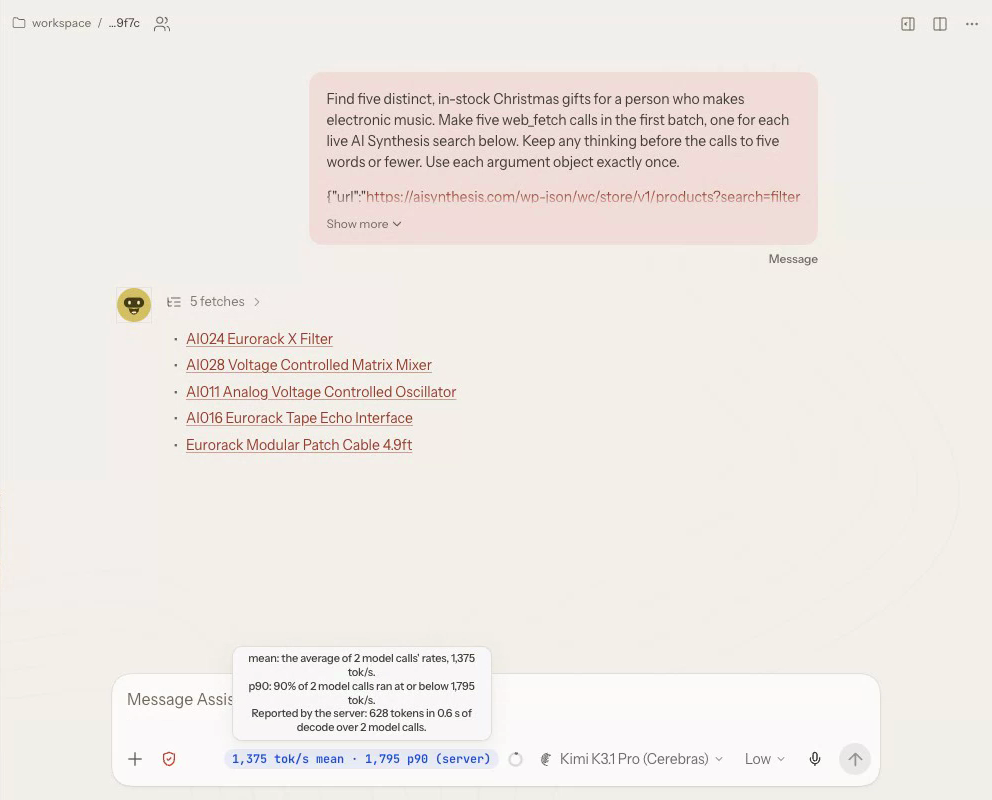

# Santa Speed Lab

We tested how fast Kimi K3.1 Pro on Cerebras could generate answers while OpenClaw shopped for five real Christmas gifts. The project grew into a second experiment: could two independent research setups build on each other’s findings through a shared Trackinizer graph?

[Venkateshwar Reddy Jambula](https://x.com/venkatGoku) and [Gabriel](https://x.com/areseyefu) built this for the Cerebras Santa’s Speedy Shopper challenge.

## The setup

| Component | What we used it for |
| --- | --- |
| **OpenClaw 2026.10.9** | Ran the shopping task in the isolated `speed-bounty` profile on macOS arm64 with Node.js 24.22.1. We kept the organizer’s measurement patch intact. |
| **Kimi K3.1 Pro on Cerebras** | Served the model. Experiment #500 streamed responses at temperature 0.3 and low reasoning effort. |
| **OpenClaw `web_fetch`** | Queried AI Synthesis’s live catalog. We supplied the searches, and OpenClaw discovered the individual products during the run. |
| **Trackinizer** | Connected the two research tracks through a shared graph hosted on Railway. Gabriel’s swarm explored output formats and decoding settings. Venkat’s agent worked on tool calls, context and multi-turn inference. |

The recorded setup and the pinned build are in the [Experiment #500 replay guide](experiment-500/README.md).

## What the replay shows

The video starts with the full 1,687-record graph, then follows one idea across the two research tracks. **Issue #202** brings the tracks together. **Web Result #110** records Gabriel’s self-closing XML format and links it to **Experiment #258**, where Venkat tested the format in the live-shopping workflow. That experiment’s result became evidence for the shared hypothesis in **Belief #346**.

https://github.com/user-attachments/assets/13f70c1c-1f45-4d9a-88cc-3b838202b82f

[Download the 29-second replay](https://github.com/Venkat-RJ/santa-speed-lab/releases/download/research-visuals-2026-11-23/santa-speed-lab-trackinizer-research-replay.mp4) · [See the focused graph](docs/assets/trackinizer-issue-202-detail.png)

## What we achieved

Our best verified run reached **1,375.40 mean TPS** across two model calls and **1,794.66 TPS** on the final call. It returned five distinct Eurorack products whose links and then-current availability we checked against the saved retailer evidence.

| Run | Session mean TPS | Final-call TPS | Evidence |
| --- | ---: | ---: | --- |
| Best verified CLI run | **1,375.40** | **1,794.66** | [Cerebras timing receipts](replay-archive/milestones/new-cli-peak/provider-stream-receipts.jsonl) |
| Original Experiment #500 | 1,284.83 | 1,597.73 | [Experiment bundle](experiment-500/) |
| Best full live recording | 1,123.45 | 1,230.92 | [Uncut OpenClaw recording](https://github.com/Venkat-RJ/santa-speed-lab/releases/download/experiment-500-proof-2026-11-23/best-live-uncut.mp4) |
| Immediate CLI replay of the best run | 818.27 | 815.75 | [Replay timing receipts](replay-archive/milestones/immediate-confirmation/provider-stream-receipts.jsonl) |



*The best CLI run reopened in OpenClaw. The dashboard shows rounded values of 1,375 mean TPS and 1,795 p90 TPS. With two calls, the patch’s p90 equals the faster call, which was the final answer in this run.* [Watch the saved session](https://github.com/Venkat-RJ/santa-speed-lab/releases/download/experiment-500-proof-2026-11-23/new-cli-peak-archived-session.mp4)

The official patch divides output tokens by Cerebras server decode time for each call, then averages the call rates. The best run generated 472 discovery tokens in 493.65 ms and 156 final-answer tokens in 86.92 ms. The lower score on the immediate replay shows how much throughput could vary under the same setup.

<details>
<summary>Five gifts and product links</summary>

1. [AI024 Eurorack X Filter](https://aisynthesis.com/product/ai024-eurorack-x-filter/)
2. [AI028 Voltage Controlled Matrix Mixer](https://aisynthesis.com/product/ai028-voltage-controlled-matrix-mixer/)
3. [AI011 Analog Voltage Controlled Oscillator](https://aisynthesis.com/product/ai011-voltage-controlled-oscillator/)
4. [AI016 Eurorack Tape Echo Interface](https://aisynthesis.com/product/ai016-eurorack-tape-echo-interface/)
5. [Eurorack Modular Patch Cable 4.9ft](https://aisynthesis.com/product/eurorack-modular-patch-cable-4-9ft/)

</details>

<details>
<summary>TPS progression across 260 attempts</summary>


The chart covers the two Venkat campaigns and later OpenClaw replays. [Watch the chart animation](https://github.com/Venkat-RJ/santa-speed-lab/releases/download/research-visuals-2026-11-23/swarm-tps-peak-11s.mp4)

</details>

## Verify or rerun

From the repository root, use Python 3.9+ and Node.js 24 to verify the saved timings and product evidence offline.

```sh
python3 experiment-500/verify.py
python3 replay-archive/verify.py
```

- [Experiment #500 replay guide](experiment-500/README.md) has the exact prompt, configuration, pinned OpenClaw build, and live rerun instructions. A live rerun needs a Cerebras key with model access. On November 23, 2026, our key received `model_not_found` from the trial endpoint.
- [Replay archive](replay-archive/README.md) indexes 80 attempts and 51 recordings, including incomplete runs and setup failures. The [evidence release](https://github.com/Venkat-RJ/santa-speed-lab/releases/tag/experiment-500-proof-2026-11-23) contains the video files and checksums.
